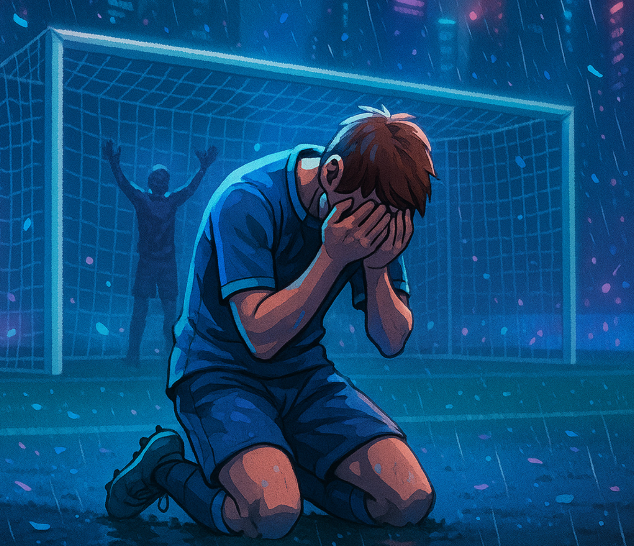

# Rehab Game: Penalty Kick

`Rehab Game: Penalty Kick` is a Unity 3D penalty kick game presented as a rehabilitation game portfolio project. Simple, intuitive shooting interactions use gameplay to convey a training rhythm, scoring feedback, and round objectives.

This repository is a **portfolio showcase**. It contains the project overview, gameplay instructions, images, and a download link for the playable build. The Unity source project, original assets, and development configuration files are not included.

## Download and Play

A packaged **Windows 64-bit build** is available on [GitHub Releases](https://github.com/painfulmoments/Soccer/releases).

1. [Download PenaltyKick-Windows.zip](https://github.com/painfulmoments/Soccer/releases/latest/download/PenaltyKick-Windows.zip).
2. Extract the entire ZIP archive to a local folder.
3. Run `PenaltyKick.exe`. Keep the accompanying data folder and runtime files together with the executable.

You do not need the Unity Editor to play this build.

## Features

- A rehabilitation game prototype built around penalty kicks
- Simple drag-based shooting controls
- Ten attempts per round with a scoring target
- Win and loss result screens
- A compact release format for portfolio presentation

## Controls

- **Hold the left mouse button and drag upward:** shoot.
- **Continue dragging after the shot:** adjust the ball's height, curve, and horizontal direction.
- **Esc:** pause or resume the game.

## How to Play

- Each round gives you **10 attempts**.
- Score by shooting the ball into the goal.
- Reach the required number of goals to win.
- At the end of a round, the result screen lets you restart or return to the main menu.

## Screenshots

## Repository Contents

- [README.md](README.md): project overview
- [guide.md](guide.md): detailed gameplay and running guide (in Chinese)
- `docs/images/`: portfolio images
- [GitHub Releases](https://github.com/painfulmoments/Soccer/releases): downloadable Windows build

## Distribution Notes

This repository is intended for portfolio presentation and does not publish the Unity source code. The executable may include licensed third-party resources integrated into the final application. Original project files and raw assets are not provided for download.
